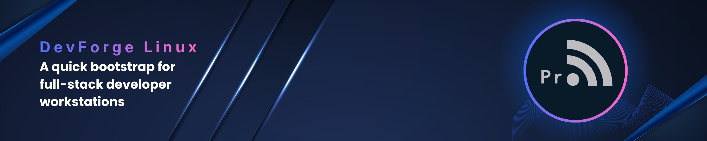

# DevForge Linux



## Fedora setup

Extract the project, open its directory, and install the command:

```bash
bash install.sh
```

Preview the complete stack, then install it:

```bash
~/.local/bin/devforge install fullstack --dry-run --yes
~/.local/bin/devforge install fullstack --yes
```

The `fullstack` preset installs Git and build tools, Ruby and Rails, Node.js LTS, Python, Rust, PostgreSQL, Podman, and the Flutter Linux SDK. It uses asdf for Ruby, Node.js, and Python versions by default, and enables a colored DevForge prompt with the current Git branch plus live installation steps.

Restart the terminal when installation finishes, then check the environment with `~/.local/bin/devforge doctor`.

PostgreSQL is initialized and started automatically. DevForge creates a local `devforge` role with permission to create databases and stores its generated password in `~/.config/devforge/postgres.env` with user-only permissions. Copy it to a project's `.env` with `cp ~/.config/devforge/postgres.env .env && chmod 600 .env`, add a project-specific `PGDATABASE`, and keep `.env` out of version control. This shared role is convenient but does not isolate projects from each other.

Android Studio, the Android SDK, JDK, and emulator require separate Flutter setup.

Do not run DevForge with `sudo`. It uses sudo only when the system package manager needs it. `--dry-run` previews actions but does not download tools or resolve every remote version.

## Other commands

```bash
devforge list
devforge menu
devforge doctor
devforge install postgres
devforge install terminal
devforge install essentials,ruby,rails,node,python,flutter
bash tests/run.sh
```

Project lockfiles and version files remain unchanged. Choose versions per project when required.

## License

MIT. See [LICENSE](LICENSE).
